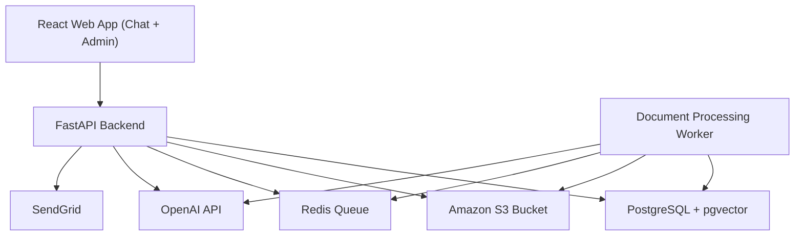
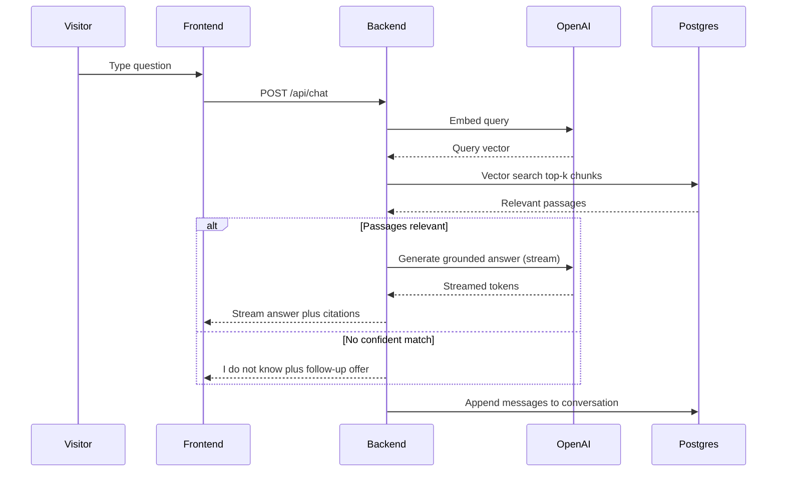
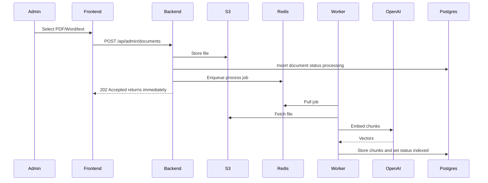
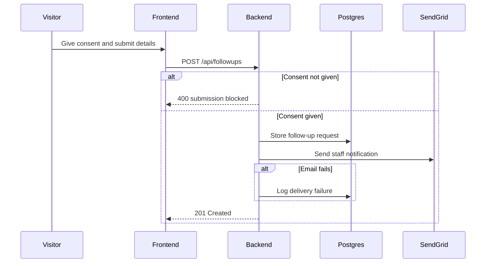
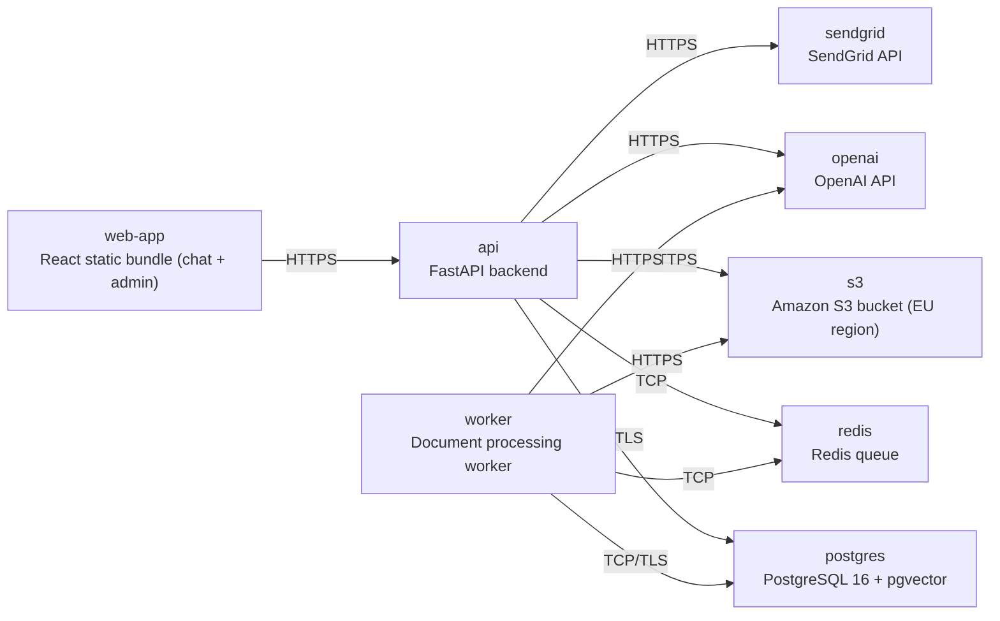

# Architecture

> Maintained by QuorQ AI SDLC. Text between `sdlc:auto` markers is regenerated; anything outside them is yours and is kept.

<!-- sdlc:auto:start narrative -->
## Overview

### ARCH-000 · approved · source: architecture:summary

TEST555 is approved (v1) as a lightweight, single-organisation document-grounded chatbot: anonymous visitors use a standalone React chat page; a FastAPI backend runs RAG over uploaded documents using OpenAI models with embeddings in PostgreSQL/pgvector.

Approved architecture, version 1. Core behaviors: bot answers only from retrieved passages, shows citations, replies 'I don't know' when unsure and offers a consent-gated follow-up form that stores a request and emails staff via SendGrid. A protected React admin area lets staff sign in to upload PDF/Word/text (stored in S3, processed asynchronously via Redis-backed worker queue), review conversations/follow-ups, and delete a visitor's personal data. Entire stack hosted in a single AWS account pinned to an EU region to meet a GDPR-level privacy standard.

- ⚠ Input does not state who approved the architecture or on what date.
- ⚠ No explicit mapping is given from architecture elements to requirement IDs (US-001..US-017); traceability below is therefore left unlinked.
- ⚠ A 'GDPR-level privacy standard' is referenced but no formal regulatory/compliance skill or control checklist was supplied, so compliance coverage cannot be verified against a named regulation.

### ARCH-001 · approved · source: architecture:component:frontend

React 19 web app serves both the anonymous chat page and the authenticated admin dashboard from one codebase.

Responsibilities: responsive standalone chat page for anonymous visitors (privacy notice, streamed answers, citations, I-don't-know fallback, consent-gated follow-up form); authenticated admin dashboard for managing documents, follow-ups, conversations and data deletion. Deployed as a React static bundle (static hosting / dev server) in deployment node 'web-app'.

- ⚠ No requirement IDs are linked to this component in the input.

### ARCH-002 · approved · source: architecture:component:backend_api

FastAPI 0.115 backend exposes chat, follow-up, auth and admin REST endpoints and runs the RAG pipeline.

Runs: query embedding, vector search, grounded generation, citation attachment, fallback logic; manages documents, conversations, consent and GDPR deletion; enqueues document processing jobs. Deployed as a Python 3.12 container in deployment node 'api'.

- ⚠ No requirement IDs are linked to this component in the input.

### ARCH-003 · approved · source: architecture:component:worker

Python document-processing worker consumes queued jobs to extract, chunk and embed uploaded documents.

Fetches uploaded files from S3, extracts text from PDF/Word/text, chunks them, creates OpenAI embeddings and indexes chunks in pgvector, updating each document's processing status. Deployed as a Python 3.12 container in deployment node 'worker'.

- ⚠ No requirement IDs are linked to this component in the input.

### ARCH-004 · approved · source: architecture:component:database

PostgreSQL 16 with pgvector is the single data store for the application.

Holds admin accounts, documents and metadata, document chunks and embeddings (pgvector), conversation logs, messages, citations and follow-up requests; supports GDPR single-point deletion. Deployed as Postgres 16 container/RDS pinned to EU region in deployment node 'postgres'.

- ⚠ No requirement IDs are linked to this component in the input.
- ⚠ Retention period and backup/restore policy for this single data store are not specified.

### ARCH-005 · approved · source: architecture:component:object_store

Amazon S3 bucket durably stores uploaded source files in an EU region.

Stores PDF/Word/text source files so they can be re-processed, replaced or removed. Deployed as deployment node 's3' (AWS S3, EU region).

- ⚠ No requirement IDs are linked to this component in the input.

### ARCH-006 · approved · source: architecture:component:queue

Redis 7 queue decouples admin document uploads from asynchronous processing.

Holds background document-processing jobs so admin uploads return immediately while parsing and embedding happen asynchronously. Deployed as redis:7-alpine container in deployment node 'redis'.

- ⚠ No requirement IDs are linked to this component in the input.

### ARCH-007 · approved · source: architecture:component:openai

OpenAI API supplies both the chat completion model and the embedding model.

Chat completion model performs grounded answer generation; embedding model is used for both documents and queries. External SaaS dependency, deployment node 'openai'.

- ⚠ No requirement IDs are linked to this component in the input.
- ⚠ No data-processing/region commitment for the OpenAI SaaS dependency is stated, which may be relevant to the EU-region privacy standard.

### ARCH-008 · approved · source: architecture:component:email

SendGrid sends follow-up notification emails to staff.

Sends an email to the configured staff inbox whenever a follow-up request is captured. External SaaS dependency, deployment node 'sendgrid'.

- ⚠ No requirement IDs are linked to this component in the input.
- ⚠ No data-processing/region commitment for the SendGrid SaaS dependency is stated.

### ARCH-009 · approved · source: architecture:critical_path:rag

Grounded chat answer (RAG) is the core visitor-facing flow.

A visitor asks a question; the backend embeds it, retrieves the nearest document chunks from pgvector, generates a grounded streamed answer with citations, or returns an honest 'I don't know' with a follow-up offer.

- ⚠ No requirement IDs are linked to this critical path in the input.

### ARCH-010 · approved · source: architecture:critical_path:document_upload

Document upload and async indexing path moves new content from admin upload into the retrieval index.

An admin uploads a file; the backend stores it in S3, records it as processing and enqueues a job; the worker extracts text, chunks, embeds and indexes it, updating status.

- ⚠ No requirement IDs are linked to this critical path in the input.

### ARCH-011 · approved · source: architecture:critical_path:followup

Follow-up capture with consent and staff email handles the fallback path when the bot cannot answer.

On fallback the visitor consents and submits contact details; the backend stores the request and sends a staff email, keeping the request even if email fails.

- ⚠ No requirement IDs are linked to this critical path in the input.

### ARCH-012 · approved · source: architecture:entities

Data model covers admin users, documents/chunks, conversations/messages/citations and follow-up requests.

Entities: admin_users(id, email, password_hash, created_at); documents(id, filename, format, s3_key, status, error_message, uploaded_by, created_at, updated_at); document_chunks(id, document_id, chunk_index, content, embedding); conversations(id, session_id, started_at); messages(id, conversation_id, role, content, created_at); message_citations(id, message_id, document_id, chunk_id); followup_requests(id, conversation_id, contact_email, question, consent_given, status, email_delivered, created_at).

- ⚠ No requirement IDs are linked to these entities in the input.
- ⚠ No explicit data retention/deletion schedule for conversations or follow-up requests beyond the ad-hoc GDPR deletion endpoint is stated.

### ARCH-013 · approved · source: architecture:endpoints

REST API surface covers visitor chat/follow-up/privacy, admin auth, document management, follow-up/conversation review and GDPR deletion.

Visitor-facing: POST /api/conversations (start session); POST /api/chat (streamed grounded answer or fallback); POST /api/followups (consent-gated, blocked without explicit consent); GET /api/privacy-notice. Admin-facing: POST /api/admin/login (JWT auth); POST /api/admin/documents (upload, queued, returns immediately); GET /api/admin/documents (list with status); PUT /api/admin/documents/{id} (replace, supersedes prior indexed content); DELETE /api/admin/documents/{id} (remove doc, chunks and S3 object); GET /api/admin/followups (list); PATCH /api/admin/followups/{id} (mark handled); GET /api/admin/conversations (list); GET /api/admin/conversations/{id} (full transcript); POST /api/admin/data-deletion (delete a visitor's personal data and relevant conversation records).

- ⚠ No requirement IDs are linked to these endpoints in the input.
- ⚠ Authorization scheme for admin endpoints beyond JWT issuance at login is not detailed (e.g. token expiry, refresh).

### ARCH-014 · approved · source: architecture:deployment

Single AWS account, EU-region deployment with containerized API/worker, managed Postgres, Redis, S3, and two external SaaS dependencies.

Deployment nodes: web-app (React static bundle, static hosting/dev server); api (FastAPI backend, Python 3.12 container); worker (document processing worker, Python 3.12 container); postgres (PostgreSQL 16 + pgvector, Postgres 16 container/RDS, EU region); redis (Redis queue, redis:7-alpine container); s3 (Amazon S3 bucket, EU region); openai (OpenAI API, SaaS); sendgrid (SendGrid API, SaaS). Entire stack pinned to a single EU region to meet the GDPR-level privacy standard.

- ⚠ No requirement IDs are linked to the deployment topology in the input.
- ⚠ 'Static hosting / dev server' for web-app leaves the actual production hosting mechanism unspecified.

### ARCH-015 · approved · source: architecture:tech_decision:frontend

React 19 selected for the frontend over Vue and Svelte.

Rationale: React 19 builds both the responsive anonymous chat page and the authenticated admin dashboard from one codebase, rendering streamed answers, citations, the privacy notice and the consent-gated follow-up form. Alternatives considered: Vue, Svelte.

- ⚠ No requirement IDs are linked to this decision in the input.

### ARCH-016 · approved · source: architecture:tech_decision:backend

FastAPI 0.115 selected for the backend over Django and Flask.

Rationale: FastAPI 0.115 hosts the visitor and admin APIs and streams OpenAI answers token-by-token for responsive chat, while the Python AI/document-parsing ecosystem supports the RAG and ingestion pipelines. Alternatives considered: Django, Flask.

- ⚠ No requirement IDs are linked to this decision in the input.

### ARCH-017 · approved · source: architecture:tech_decision:database

PostgreSQL 16 (with pgvector) selected over MySQL and MongoDB.

Rationale: PostgreSQL 16 with pgvector holds documents, chunks and embeddings, conversation logs and follow-up requests in one store, so retrieval and GDPR single-point deletion share one backup-and-restore system. Alternatives considered: MySQL, MongoDB.

- ⚠ No requirement IDs are linked to this decision in the input.

### ARCH-018 · approved · source: architecture:tech_decision:cloud

AWS selected as the cloud provider over Google Cloud and Azure.

Rationale: AWS runs the FastAPI service, PostgreSQL and the S3 document bucket in one EU-pinned account, providing the data-residency and audit controls the GDPR-level privacy promise needs without self-run servers. Alternatives considered: Google Cloud, Azure.

- ⚠ No requirement IDs are linked to this decision in the input.
- ⚠ 'GDPR-level privacy standard' and 'audit controls' are referenced as motivation but no specific regulation or audit-control checklist is named for verification.
<!-- sdlc:auto:end narrative -->

<!-- sdlc:auto:start building-blocks -->
## Building Block View

| ID | Name | Technology | Responsibility | Depends on |
|---|---|---|---|---|
| frontend | React Web App (Chat + Admin) | React 19 | Serves the responsive standalone chat page for anonymous visitors (with privacy notice, citations, I-don't-know fallback and consent-gated follow-up form) and the authenticated admin dashboard for documents, follow-ups, conversations and data deletion. | backend_api |
| backend_api | FastAPI Backend | FastAPI 0.115 | Exposes chat (streamed), follow-up, auth and admin REST endpoints; runs the RAG pipeline (embed query, vector search, grounded generation, citations, fallback); manages documents, conversations, consent and GDPR deletion; enqueues document processing jobs. | database, object_store, queue, openai, email |
| worker | Document Processing Worker | Python (FastAPI 0.115 app worker) | Consumes queued jobs to fetch uploaded files from S3, extract text from PDF/Word/text, chunk them, create OpenAI embeddings and index chunks in pgvector, updating each document's processing status. | database, object_store, queue, openai |
| database | PostgreSQL + pgvector | PostgreSQL 16 | Single store for admin accounts, documents and metadata, document chunks and their embeddings (pgvector), conversation logs, messages, citations and follow-up requests; supports GDPR single-point deletion. | — |
| object_store | Amazon S3 Bucket | Amazon S3 | Durably stores uploaded source files (PDF/Word/text) in an EU region so they can be re-processed, replaced or removed. | — |
| queue | Redis Queue | Redis 7 | Holds background document-processing jobs so admin uploads return immediately while parsing and embedding happen asynchronously. | — |
| openai | OpenAI API | OpenAI (SaaS) | Provides the chat completion model for grounded answer generation and the embedding model for documents and queries. | — |
| email | SendGrid | SendGrid (SaaS) | Sends follow-up notification emails to the configured staff inbox when a follow-up request is captured. | — |

<!-- sdlc:auto:end building-blocks -->

<!-- sdlc:auto:start runtime -->
## Runtime View

### Grounded chat answer (RAG)

A visitor asks a question; the backend embeds it, retrieves the nearest document chunks from pgvector, generates a grounded streamed answer with citations, or returns an honest 'I don't know' with a follow-up offer.

- **Components:** frontend, backend_api, database, openai
- **Modules:** chat_router, rag_service, retrieval_repo, openai_client
- **Key functions:** post_chat(conversation_id, message), embed_query(text), search_chunks(embedding, top_k), generate_answer(context, history), build_citations(chunks)

### Document upload and async indexing

An admin uploads a file; the backend stores it in S3, records it as processing and enqueues a job; the worker extracts text, chunks, embeds and indexes it, updating status.

- **Components:** frontend, backend_api, object_store, queue, worker, openai, database
- **Modules:** admin_documents_router, storage_service, job_queue, ingestion_worker, chunker, embedding_service
- **Key functions:** upload_document(file), put_object(bucket, key, bytes), enqueue_process(document_id), extract_text(file), chunk_text(text), embed_chunks(chunks), index_chunks(document_id, vectors)

### Follow-up capture with consent and staff email

On fallback the visitor consents and submits contact details; the backend stores the request and sends a staff email, keeping the request even if email fails.

- **Components:** frontend, backend_api, database, email
- **Modules:** followup_router, followup_service, email_client
- **Key functions:** create_followup(contact, question, consent), store_request(request), send_staff_email(request)

<!-- sdlc:auto:end runtime -->

<!-- sdlc:auto:start deployment-view -->
## Deployment View

| Name | Service | Runtime | Scaling | Environment |
|---|---|---|---|---|
| web-app | React static bundle (chat + admin) | Static hosting / dev server | single | dev |
| api | FastAPI backend | Python 3.12 container | single | dev |
| worker | Document processing worker | Python 3.12 container | single | dev |
| postgres | PostgreSQL 16 + pgvector | Postgres 16 container/RDS (EU region) | single | dev |
| redis | Redis queue | redis:7-alpine container | single | dev |
| s3 | Amazon S3 bucket (EU region) | AWS S3 | managed | dev |
| openai | OpenAI API | SaaS | managed | dev |
| sendgrid | SendGrid API | SaaS | managed | dev |

| Source | Target | Protocol |
|---|---|---|
| web-app | api | HTTPS |
| api | postgres | TCP/TLS |
| api | redis | TCP |
| api | s3 | HTTPS |
| api | openai | HTTPS |
| api | sendgrid | HTTPS |
| worker | redis | TCP |
| worker | postgres | TCP/TLS |
| worker | s3 | HTTPS |
| worker | openai | HTTPS |

<!-- sdlc:auto:end deployment-view -->

<!-- sdlc:auto:start decisions -->
## Architecture Decisions

| Layer | Choice | ADR |
|---|---|---|
| Frontend | React 19 | [ADR-0001](adr/frontend.md) |
| Backend | FastAPI 0.115 | [ADR-0002](adr/backend.md) |
| Database | PostgreSQL 16 | [ADR-0003](adr/database.md) |
| Cloud | AWS | [ADR-0004](adr/cloud.md) |
<!-- sdlc:auto:end decisions -->

<!-- sdlc:auto:start links -->
## Related Documents

- [Data Model](data-model.md)
- [API Specification](api/openapi.yaml)
- [Architecture Decision Records](adr/README.md)
<!-- sdlc:auto:end links -->
