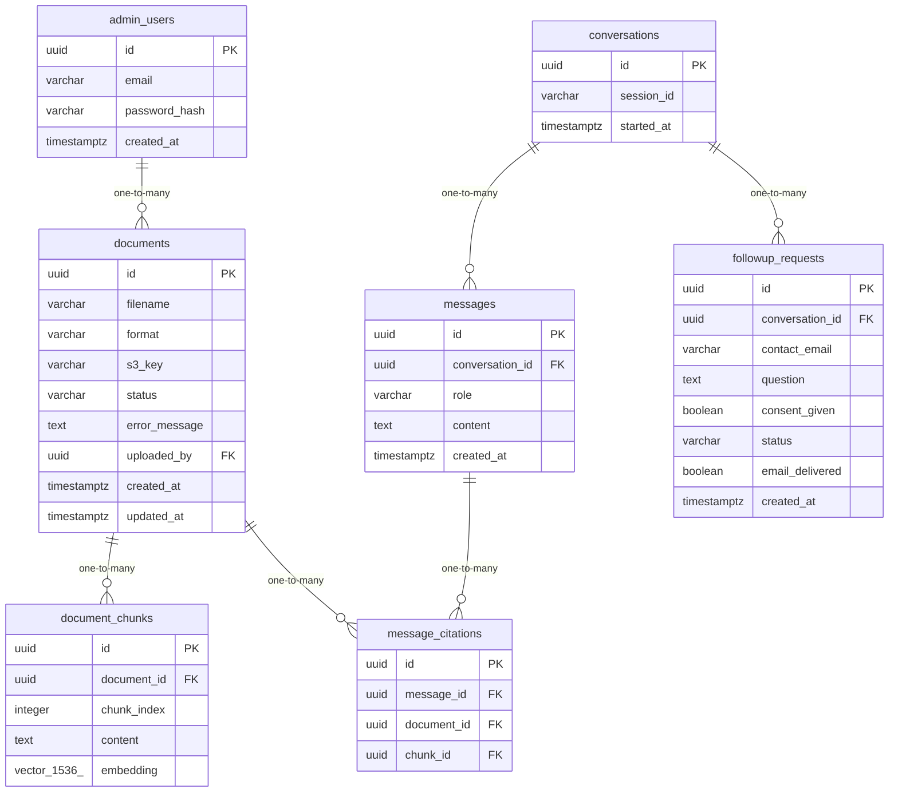

# Data Model

<!-- sdlc:auto:start entities -->
### admin_users

| Field | Type | PK | FK | Nullable |
|---|---|---|---|---|
| id | uuid | True | — | False |
| email | varchar | False | — | False |
| password_hash | varchar | False | — | False |
| created_at | timestamptz | False | — | False |

### documents

| Field | Type | PK | FK | Nullable |
|---|---|---|---|---|
| id | uuid | True | — | False |
| filename | varchar | False | — | False |
| format | varchar | False | — | False |
| s3_key | varchar | False | — | False |
| status | varchar | False | — | False |
| error_message | text | False | — | True |
| uploaded_by | uuid | False | admin_users.id | False |
| created_at | timestamptz | False | — | False |
| updated_at | timestamptz | False | — | False |

### document_chunks

| Field | Type | PK | FK | Nullable |
|---|---|---|---|---|
| id | uuid | True | — | False |
| document_id | uuid | False | documents.id | False |
| chunk_index | integer | False | — | False |
| content | text | False | — | False |
| embedding | vector(1536) | False | — | False |

### conversations

| Field | Type | PK | FK | Nullable |
|---|---|---|---|---|
| id | uuid | True | — | False |
| session_id | varchar | False | — | False |
| started_at | timestamptz | False | — | False |

### messages

| Field | Type | PK | FK | Nullable |
|---|---|---|---|---|
| id | uuid | True | — | False |
| conversation_id | uuid | False | conversations.id | False |
| role | varchar | False | — | False |
| content | text | False | — | False |
| created_at | timestamptz | False | — | False |

### message_citations

| Field | Type | PK | FK | Nullable |
|---|---|---|---|---|
| id | uuid | True | — | False |
| message_id | uuid | False | messages.id | False |
| document_id | uuid | False | documents.id | False |
| chunk_id | uuid | False | document_chunks.id | True |

### followup_requests

| Field | Type | PK | FK | Nullable |
|---|---|---|---|---|
| id | uuid | True | — | False |
| conversation_id | uuid | False | conversations.id | True |
| contact_email | varchar | False | — | False |
| question | text | False | — | False |
| consent_given | boolean | False | — | False |
| status | varchar | False | — | False |
| email_delivered | boolean | False | — | False |
| created_at | timestamptz | False | — | False |
<!-- sdlc:auto:end entities -->

<!-- sdlc:auto:start relationships -->
| Source | Target | Type |
|---|---|---|
| admin_users | documents | one-to-many |
| documents | document_chunks | one-to-many |
| conversations | messages | one-to-many |
| messages | message_citations | one-to-many |
| documents | message_citations | one-to-many |
| conversations | followup_requests | one-to-many |
<!-- sdlc:auto:end relationships -->

<!-- sdlc:auto:start er-diagram -->

<!-- sdlc:auto:end er-diagram -->
