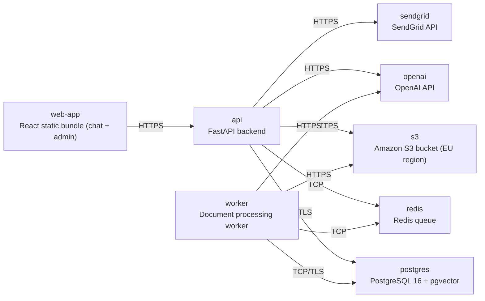

# Deployment Guide

> Maintained by QuorQ AI SDLC. Text between `sdlc:auto` markers is regenerated; anything outside them is yours and is kept.

<!-- sdlc:auto:start how-it-deploys -->
Pushes to `main` run `.github/workflows/deploy.yml`, which builds the API image (if there is a backend) and deploys the SPA to AWS Amplify. Commits touching only `docs/sdlc/**` don't deploy. Deployments can also be started from the platform's Deployment tab.
<!-- sdlc:auto:end how-it-deploys -->

<!-- sdlc:auto:start environments -->
| Name | Service | Runtime | Scaling | Environment |
|---|---|---|---|---|
| web-app | React static bundle (chat + admin) | Static hosting / dev server | single | dev |
| api | FastAPI backend | Python 3.12 container | single | dev |
| worker | Document processing worker | Python 3.12 container | single | dev |
| postgres | PostgreSQL 16 + pgvector | Postgres 16 container/RDS (EU region) | single | dev |
| redis | Redis queue | redis:7-alpine container | single | dev |
| s3 | Amazon S3 bucket (EU region) | AWS S3 | managed | dev |
| openai | OpenAI API | SaaS | managed | dev |
| sendgrid | SendGrid API | SaaS | managed | dev |
<!-- sdlc:auto:end environments -->

<!-- sdlc:auto:start live -->
_Not deployed yet._
<!-- sdlc:auto:end live -->

<!-- sdlc:auto:start topology -->

<!-- sdlc:auto:end topology -->
